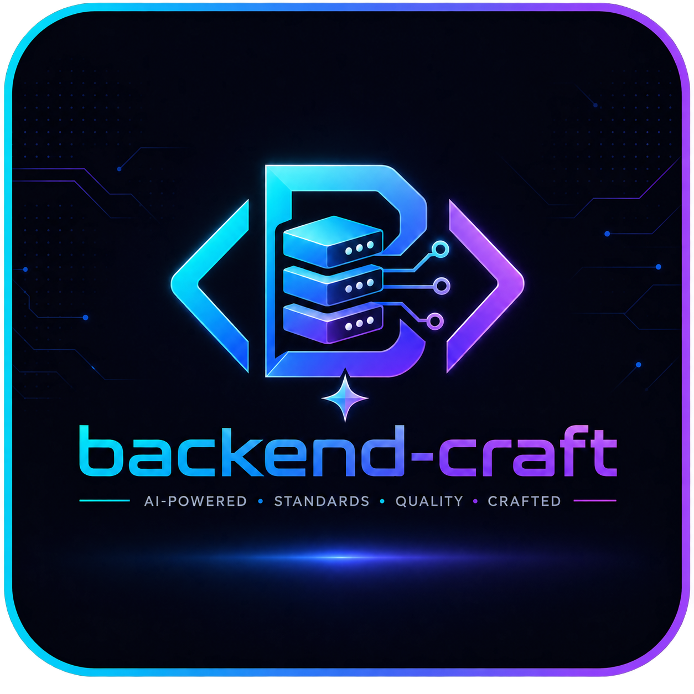

<div align="center">



# Backend Craft

### Backend engineering workflows for your AI coding assistant.

[](https://github.com/bovinphang/backend-craft/actions/workflows/ci.yml)
[](https://www.npmjs.com/package/@bovinphang/backend-craft)
[](LICENSE)


**🌐 Language / 语言 / 語言 / 言語 / 언어**

[**English**](README.md) · [简体中文](README.zh-CN.md) · [繁體中文](docs/zh-TW/README.md) · [日本語](docs/ja-JP/README.md) · [한국어](docs/ko-KR/README.md)

</div>

Backend Craft brings architecture, API, data, security, testing and troubleshooting workflows to the following **15 AI coding assistants**:

`claude` `codex` `cursor` `windsurf` `opencode`
`kilo` `gemini` `copilot` `antigravity` `augment`
`trae` `codebuddy` `cline` `openclaw` `qoder`

Per-runtime paths and caveats live in the [runtime guide](docs/runtimes/README.md).

It includes **21 backend skills**, **21 shared engineering skills**, **8 agents** and **8 command workflows**. The README is available in five languages; installable skills, agents and command workflows are available in English and Simplified Chinese.

Service guidance covers Rust, Go, Java, Python, C and C++, with dedicated Spring Boot, FastAPI, Gin, Axum and Drogon skills. Shared `cc-*` foundations also cover TypeScript, Electron and Tauri.

[Documentation](docs/README.md) · [Example prompts](docs/example-prompts.md) · [Contributing](CONTRIBUTING.md) · [Changelog](CHANGELOG.md)

## Core capabilities

- Plan service evolution with architecture, API, storage, caching and transaction workflows.
- Apply shared language standards and five framework specialties within existing project conventions.
- Use dedicated code, security, performance, debugging and test-planning agents.
- Inspect projects, preview validation plans and execute checks through existing local tools.
- Generate runtime-specific resources, track ownership and share common content with Frontend Craft.

**Skills** provide task-specific guidance, **agents** handle focused engineering tasks, and **command workflows** are assistant entry points where supported. They are distinct from terminal commands such as `bec setup`.

## Quick start

You need **Node.js 22+**, an installed AI coding assistant and an existing backend project. The CLI supports Windows, macOS and Linux.

### 1. Install and connect your assistant

```sh
npm install -g @bovinphang/backend-craft@latest
cd your-backend-project
bec setup
```

Replace `your-backend-project` with your project directory. In an interactive terminal, `bec setup` lets you select one or more AI runtimes (coding assistants), then the resource language: English or Simplified Chinese. Use Up/Down to navigate, Space to toggle selections and Enter to confirm. Claude is selected initially; deselect it if you only want another assistant. Resources are installed into the **current project** by default.

To skip the prompts or use a script, specify the runtime, scope and language explicitly. For example, to connect Codex:

```sh
bec setup codex --local --lang en
```

### 2. Check the installation

Run the check from the same project directory. This example uses Codex; replace `codex` with each runtime you selected from the [supported runtime list](docs/runtimes/README.md).

```sh
bec doctor codex --local --json
```

`installed: true` means a managed installation exists; `filesHealthy: true` means its resources are intact. `enabled: "unknown"` means the CLI cannot confirm activation inside the assistant. If either installation check is false, review the diagnostics and the [runtime guide](docs/runtimes/README.md) before continuing.

### 3. Run your first task

Restart or refresh your assistant, open the target project and start a new conversation. Confirm the installed resources are discovered and enable them if the host requires trust or approval. Where skills are supported, use this prompt, replacing `services/orders` with an existing module:

```text
Use bec-code-review to review services/orders without modifying code.
Follow this repository's conventions and prioritize authorization, transaction boundaries and error handling.
List findings with file locations, impact and suggested fixes; state explicitly if no issues are found.
```

Expect a review with actionable findings or an explicit no-findings result. Claude Code also exposes `/bec-review` and `/bec-debug`; Codex uses skills and agents. Resource forms vary by host: see the [runtime guide](docs/runtimes/README.md) and [example prompts](docs/example-prompts.md).

## Other installation options

### Run without a global CLI

This is an alternative to the global CLI. Prefix subsequent CLI commands with `npx @bovinphang/backend-craft@latest` as well.

```sh
cd your-backend-project
npx @bovinphang/backend-craft@latest setup
```

### Claude Code native plugin

Run these commands inside Claude Code. Choose one installation channel per runtime; CLI installation and the native plugin must not be installed together for the same runtime. See the [runtime guide](docs/runtimes/README.md) for activation and channel switching.

```text
/plugin marketplace add bovinphang/backend-craft
/plugin install backend-craft@backend-craft
```

### User-wide installation

Use `--global` to share resources across projects for your user. The example selects Codex explicitly; avoid installing both scopes unless intended. Batch setup and full defaults are documented in [CLI management](docs/cli-management.md).

```sh
bec setup codex --global --lang en
```

## Capability catalog

### Backend skills

| Area | Skills |
| --- | --- |
| Service design | `bec-architecture-design`, `bec-api-design` |
| Data and consistency | `bec-database-design`, `bec-cache-design`, `bec-transaction-management` |
| Security and operations | `bec-auth-security`, `bec-observability`, `bec-performance-optimization` |
| Delivery and maintenance | `bec-project-init`, `bec-code-review`, `bec-debug-framework`, `bec-testing-strategy`, `bec-tdd-workflow`, `bec-refactoring`, `bec-dependency-management`, `bec-doc-sync` |
| Service frameworks | `bec-spring-boot-project-standard`, `bec-fastapi-project-standard`, `bec-gin-project-standard`, `bec-axum-project-standard`, `bec-drogon-project-standard` |

### Shared engineering skills

| Area | Skills |
| --- | --- |
| Languages | `cc-typescript-project-standard`, `cc-rust-project-standard`, `cc-go-project-standard`, `cc-java-project-standard`, `cc-python-project-standard`, `cc-c-project-standard`, `cc-cpp-project-standard` |
| Runtime and concurrency | `cc-rust-async`, `cc-go-concurrency`, `cc-java-runtime`, `cc-python-async`, `cc-native-memory-safety` |
| Desktop | `cc-electron-project-standard`, `cc-tauri-project-standard` |
| Engineering methods | `cc-source-driven-development`, `cc-doc-sync-core`, `cc-debug-methodology`, `cc-refactoring-core`, `cc-tdd-methodology` |
| Diagrams | `cc-drawio-studio`, `cc-technical-diagrams` |

### Agents

| Agent | Purpose |
| --- | --- |
| `bec-architect` | Architecture and module-boundary planning |
| `bec-code-reviewer` | Backend code review |
| `bec-security-reviewer` | Authentication, authorization and service security review |
| `bec-performance-optimizer` | Performance diagnosis and optimization |
| `bec-debugger` | Failure diagnosis and verified repair |
| `bec-test-planner` | Risk-based test strategy |
| `bec-refactoring-expert` | Behavior-preserving refactoring |
| `bec-doc-updater` | Documentation synchronization |

### Assistant commands

| Command | Purpose |
| --- | --- |
| `/bec-init` | Initialize project guidance |
| `/bec-plan` | Plan architecture or testing |
| `/bec-review` | Review backend code |
| `/bec-debug` | Diagnose and repair failures |
| `/bec-tdd` | Apply a test-driven workflow |
| `/bec-refactor` | Refactor with behavior checks |
| `/bec-doc-sync` | Synchronize documentation |
| `/bec-validate` | Preview and execute validation |

These are assistant workflows. Run terminal validation with `bec validate`. Workflow reports use `reports/backend-craft/`. Agents specify filenames within that directory.

## Configuration and validation

Project validation needs your project's existing toolchain and installed dependencies.

### Inspect and validate a project

```sh
bec project inspect . --json
bec project inspect . --task-path services/api/main.go --task-kind api --json
bec validate . --dry-run --json
bec validate . --json
```

Inspection reads project evidence and recommends matching capabilities. Review the plan before execution. Validation uses explicit configuration, existing project tasks or conservative language suggestions. Exit codes are `0` for passed, `1` for failed and `2` for incomplete or invalid input. Missing required tools, skipped required stages and zero tests prevent a passing result.

- [Language guide](docs/languages/README.md) describes six-language validation. Shared skill coverage is maintained separately.
- [Validation configuration](docs/validation-config.md) covers `.backend-craft.json`, stage execution and test evidence. Integration stages require explicit enablement.
- Automatic formatting and validation are disabled by default. Native Claude SessionStart provides read-only context. Native OpenClaw can opt into `autoValidate` and, with a configured `formatStage`, `autoFormat`.
- The [HTTP replay example](skills/bec-api-design/examples/engineering/README.md) demonstrates idempotency scenarios.

## Update and uninstall

```sh
bec update --dry-run
bec update
bec runtime update codex --local
bec runtime uninstall codex --local
bec uninstall --yes
```

`bec update` verifies the original npm/pnpm installation, upgrades the CLI and refreshes managed resources in the current project and globally. `runtime update` uses installed content and preserves each installation's language unless overridden. `bec uninstall` removes the CLI and retains resources. Add `--purge` to clean discovered product resources first.

Modified and unknown files are protected. Shared `cc-*` resources require matching common versions, languages and content digests. Before upgrading a mixed installation, run `bec runtime check-migration codex --local --json` with the applicable runtime and scope. See [coexistence and migration](docs/coexistence.md).

## Documentation

| Guide | Contents |
| --- | --- |
| [Runtime installation and activation](docs/runtimes/README.md) | Supported assistants, resource paths and host discovery |
| [CLI management](docs/cli-management.md) | Scopes, batch operations, updates and removal |
| [Example prompts](docs/example-prompts.md) | Architecture, review and troubleshooting tasks |
| [Validation configuration](docs/validation-config.md) | Project checks and test evidence |
| [Coexistence and migration](docs/coexistence.md) | Shared resources and installation conflicts |
| [Documentation index](docs/README.md) | Language guides, engineering structure and extensions |

## Source development and contributing

Domain skills, agents and workflows are maintained here. Shared `cc-*` skills and common methods are maintained in [craft-common](https://github.com/bovinphang/craft-common). `pnpm build` assembles the complete English and Simplified Chinese product in `dist/package/`; load this assembled directory for local development and Git submodules.

Use Node.js 22+ and the pnpm version declared in `package.json`. Dependency versions are defined by `package.json` and `pnpm-lock.yaml`. Run:

```sh
git clone https://github.com/bovinphang/backend-craft.git
cd backend-craft
pnpm install --frozen-lockfile
pnpm build
node dist/package/dist/bin/backend-craft.js version
```

To load the built Claude plugin, run this from the repository root:

```sh
claude --plugin-dir ./dist/package
```

See [Contributing](CONTRIBUTING.md) for development checks, bilingual maintenance and release archives (`pnpm run pack:all`). Report reproducible problems through [GitHub Issues](https://github.com/bovinphang/backend-craft/issues).

## License

[MIT](LICENSE) © bovinphang.
