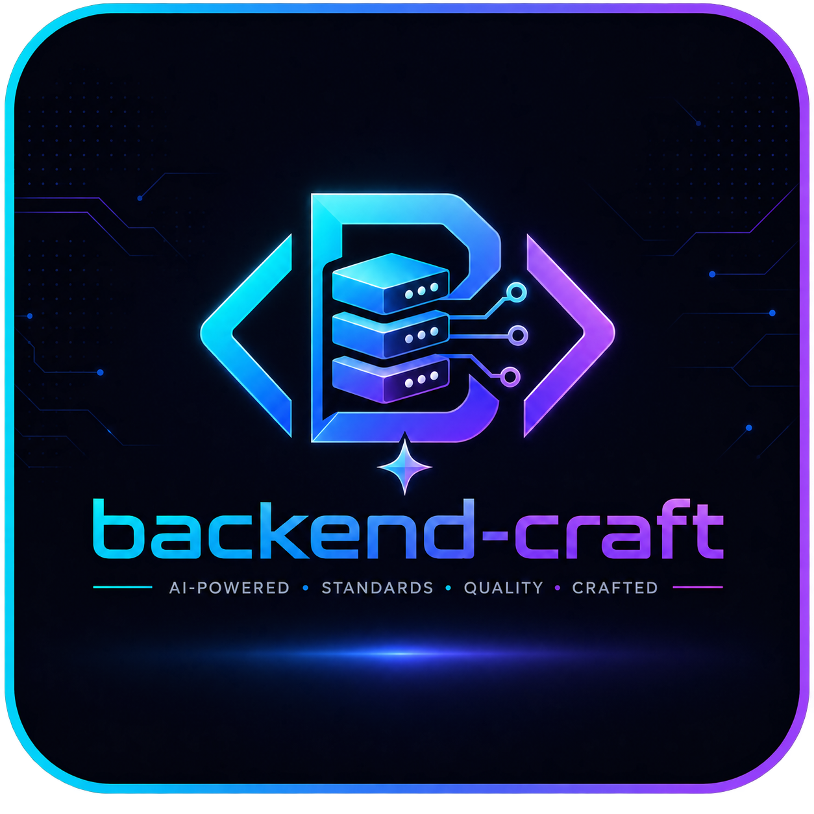

<div align="center">



# Backend Craft

### 将后端工程规范与工作流接入你的 AI 编程助手。

[](https://github.com/bovinphang/backend-craft/actions/workflows/ci.yml)
[](https://www.npmjs.com/package/@bovinphang/backend-craft)
[](LICENSE)


**🌐 Language / 语言 / 語言 / 言語 / 언어**

[English](README.md) · [**简体中文**](README.zh-CN.md) · [繁體中文](docs/zh-TW/README.md) · [日本語](docs/ja-JP/README.md) · [한국어](docs/ko-KR/README.md)

</div>

Backend Craft 将架构、API、数据、安全、测试与故障诊断工作流接入以下 **15 款 AI 编程助手**：

`claude` `codex` `cursor` `windsurf` `opencode`
`kilo` `gemini` `copilot` `antigravity` `augment`
`trae` `codebuddy` `cline` `openclaw` `qoder`

各 Runtime 的路径与注意事项详见 [Runtime 指南](docs/runtimes/README.zh-CN.md)。

提供 **21 个后端 Skill**、**21 个公共工程 Skill**、**8 个 Agent** 与 **8 个命令工作流**。README 提供五种语言版本；可安装的 Skill、Agent 和命令工作流提供英文、简体中文内容。

服务工程覆盖 Rust、Go、Java、Python、C、C++，提供 Spring Boot、FastAPI、Gin、Axum、Drogon 专项。公共 `cc-*` 底座还覆盖 TypeScript、Electron、Tauri。

[文档导航](docs/README.zh-CN.md) · [示例提示词](docs/example-prompts.zh-CN.md) · [贡献指南](CONTRIBUTING.zh-CN.md) · [变更日志](CHANGELOG.zh-CN.md)

## 核心能力

- 使用架构、API、存储、缓存和事务工作流规划服务演进。
- 结合公共语言规范与五个框架专项，遵循已有项目约定。
- 使用代码、安全、性能、调试和测试规划 Agent 处理工程任务。
- 只读识别项目，预览验证计划，使用现有本地工具执行检查。
- 为不同助手生成适配资源，跟踪所有权，并与 Frontend Craft 共享公共内容。

**Skill** 提供特定任务的规范与方法，**Agent** 负责专项工程任务，**命令工作流**提供宿主支持的快捷入口；它们与终端中的 `bec setup` 等 CLI 命令不同。

## 快速开始

准备 **Node.js 22+**、已安装的 AI 编程助手，以及一个已有后端项目。CLI 支持 Windows、macOS 和 Linux。

### 1. 安装并接入助手

```sh
npm install -g @bovinphang/backend-craft@latest
cd your-backend-project
bec setup
```

将 `your-backend-project` 替换为实际项目目录。在交互终端中，`bec setup` 会先让你选择一个或多个 AI 运行时（编程助手），再选择英文或简体中文资源。使用方向键移动、空格勾选或取消、回车确认。初始勾选 Claude；只接入其他助手时，先取消该选项。资源默认安装到**当前项目**。

需要跳过交互或编写脚本时，显式指定运行时、安装范围和语言。以 Codex 为例：

```sh
bec setup codex --local --lang zh-CN
```

### 2. 检查安装结果

在同一项目目录执行检查。以下以 Codex 为例；请将 `codex` 替换为[支持列表](docs/runtimes/README.zh-CN.md)中实际选择的运行时标识，多选时逐个检查。

```sh
bec doctor codex --local --json
```

`installed: true` 表示存在托管安装，`filesHealthy: true` 表示资源完整。`enabled: "unknown"` 表示 CLI 无法确认助手内部是否已启用资源。前两项为 false 时，先根据诊断信息和 [Runtime 指南](docs/runtimes/README.zh-CN.md)排查。

### 3. 完成首次任务

刷新或重启助手，打开目标项目并新建会话，确认助手已发现安装的资源；如宿主要求信任或启用，请完成相应操作。对于支持 Skill 的助手，可发送以下提示词，将 `services/orders` 替换为实际存在的模块路径：

```text
使用 bec-code-review 对 services/orders 做只读代码评审，不修改代码。
遵循本仓库约定，优先检查授权、事务边界和错误处理。
列出问题位置、影响与修复建议；如果没有发现问题，请明确说明。
```

预期得到包含问题位置、影响和修复建议的评审结果，或明确的无问题结论。Claude Code 还提供 `/bec-review`、`/bec-debug` 等工作流，Codex 使用 Skill 和 Agent。不同宿主的资源形式见 [Runtime 指南](docs/runtimes/README.zh-CN.md)，更多任务见[示例提示词](docs/example-prompts.zh-CN.md)。

## 其他安装方式

### 临时 npx 运行

不安装全局 CLI 时使用此方式。后续 CLI 命令也需要使用 `npx @bovinphang/backend-craft@latest` 前缀执行。

```sh
cd your-backend-project
npx @bovinphang/backend-craft@latest setup
```

### Claude Code 原生插件

在 Claude Code 内执行以下命令。每个运行时选择一种安装渠道，同一运行时的 CLI 接入与原生插件不能同时安装。启用和切换渠道见 [Runtime 指南](docs/runtimes/README.zh-CN.md)。

```text
/plugin marketplace add bovinphang/backend-craft
/plugin install backend-craft@backend-craft
```

### 用户级全局接入

需要跨项目使用时，以 `--global` 安装到用户级目录。以下显式选择 Codex；按需选择范围，避免无意中同时安装本地与全局资源。批量接入和完整默认值见 [CLI 管理](docs/cli-management.zh-CN.md)。

```sh
bec setup codex --global --lang zh-CN
```

## 能力目录

### 后端 Skill

| 领域 | Skill |
| --- | --- |
| 服务设计 | `bec-architecture-design`、`bec-api-design` |
| 数据与一致性 | `bec-database-design`、`bec-cache-design`、`bec-transaction-management` |
| 安全与运行保障 | `bec-auth-security`、`bec-observability`、`bec-performance-optimization` |
| 交付与维护 | `bec-project-init`、`bec-code-review`、`bec-debug-framework`、`bec-testing-strategy`、`bec-tdd-workflow`、`bec-refactoring`、`bec-dependency-management`、`bec-doc-sync` |
| 服务框架 | `bec-spring-boot-project-standard`、`bec-fastapi-project-standard`、`bec-gin-project-standard`、`bec-axum-project-standard`、`bec-drogon-project-standard` |

### 公共工程 Skill

| 领域 | Skill |
| --- | --- |
| 语言 | `cc-typescript-project-standard`、`cc-rust-project-standard`、`cc-go-project-standard`、`cc-java-project-standard`、`cc-python-project-standard`、`cc-c-project-standard`、`cc-cpp-project-standard` |
| 运行时与并发 | `cc-rust-async`、`cc-go-concurrency`、`cc-java-runtime`、`cc-python-async`、`cc-native-memory-safety` |
| 桌面 | `cc-electron-project-standard`、`cc-tauri-project-standard` |
| 工程方法 | `cc-source-driven-development`、`cc-doc-sync-core`、`cc-debug-methodology`、`cc-refactoring-core`、`cc-tdd-methodology` |
| 图表 | `cc-drawio-studio`、`cc-technical-diagrams` |

### Agent

| Agent | 用途 |
| --- | --- |
| `bec-architect` | 架构与模块边界规划 |
| `bec-code-reviewer` | 后端代码评审 |
| `bec-security-reviewer` | 认证、授权与服务安全评审 |
| `bec-performance-optimizer` | 性能诊断与优化 |
| `bec-debugger` | 故障诊断与验证修复 |
| `bec-test-planner` | 基于风险的测试策略 |
| `bec-refactoring-expert` | 保持行为的重构 |
| `bec-doc-updater` | 文档同步 |

### 助手命令

| 命令 | 用途 |
| --- | --- |
| `/bec-init` | 初始化项目指导内容 |
| `/bec-plan` | 架构或测试规划 |
| `/bec-review` | 后端代码评审 |
| `/bec-debug` | 诊断与修复故障 |
| `/bec-tdd` | 测试驱动工作流 |
| `/bec-refactor` | 结合行为验证重构 |
| `/bec-doc-sync` | 同步项目文档 |
| `/bec-validate` | 预览和执行工程验证 |

这些是助手工作流，终端验证使用 `bec validate`。报告写入 `reports/backend-craft/`，Agent 在该目录使用各自定义的文件名。

## 配置与验证

项目验证需要已有工具链及准备完成的项目依赖。

### 识别和验证项目

```sh
bec project inspect . --json
bec project inspect . --task-path services/api/main.go --task-kind api --json
bec validate . --dry-run --json
bec validate . --json
```

识别读取工程证据并推荐适用能力。执行前先审阅验证计划。验证使用显式配置、项目已有任务或保守语言候选。退出码 `0` 表示通过，`1` 表示失败，`2` 表示不完整或输入无效。缺少必需工具、必需阶段被跳过、零测试均无法通过。

- [语言指南](docs/languages/README.zh-CN.md)介绍六语言验证，公共 Skill 的语言覆盖单独维护。
- [验证配置](docs/validation-config.zh-CN.md)介绍 `.backend-craft.json`、阶段执行与测试证据，集成阶段需显式启用。
- 自动格式与验证默认关闭。Claude 原生 SessionStart Hook 提供只读上下文；OpenClaw 原生插件可开启 `autoValidate`，配置 `formatStage` 后可开启 `autoFormat`。
- [HTTP 重放样例](skills/bec-api-design/examples/engineering/README.md)演示幂等场景。

## 更新与卸载

```sh
bec update --dry-run
bec update
bec runtime update codex --local
bec runtime uninstall codex --local
bec uninstall --yes
```

`bec update` 核实原 npm/pnpm 来源，升级 CLI 后刷新当前项目及全局托管资源。`runtime update` 使用当前包内容，默认沿用每个安装的语言。`bec uninstall` 卸载 CLI 并保留资源，添加 `--purge` 可先清理发现的本产品资源。

用户修改与未知文件受到保护。跨产品共享 `cc-*` 要求公共包版本、语言与内容摘要一致。升级混合安装前，按实际 Runtime 和安装范围运行 `bec runtime check-migration codex --local --json`。详见[共存与迁移](docs/coexistence.zh-CN.md)。

## 文档导航

| 指南 | 内容 |
| --- | --- |
| [Runtime 安装与启用](docs/runtimes/README.zh-CN.md) | 支持的助手、资源路径与宿主发现 |
| [CLI 管理](docs/cli-management.zh-CN.md) | 安装范围、批量操作、更新与卸载 |
| [示例提示词](docs/example-prompts.zh-CN.md) | 架构、评审与故障诊断任务 |
| [验证配置](docs/validation-config.zh-CN.md) | 项目检查与测试证据 |
| [共存与迁移](docs/coexistence.zh-CN.md) | 共享资源与安装冲突 |
| [完整文档导航](docs/README.zh-CN.md) | 语言指南、工程结构及扩展 |

## 源码开发与贡献

本仓库维护后端领域 Skill、Agent 和工作流，公共 `cc-*` Skill 与工程方法在 [craft-common](https://github.com/bovinphang/craft-common) 统一维护。`pnpm build` 在 `dist/package/` 组合生成完整英文和简体中文产品。本地开发及 Git 子模块应加载该组合目录。

使用 Node.js 22+ 和 `package.json` 声明的 pnpm 版本；依赖版本以 `package.json` 和 `pnpm-lock.yaml` 为准。按以下顺序构建：

```sh
git clone https://github.com/bovinphang/backend-craft.git
cd backend-craft
pnpm install --frozen-lockfile
pnpm build
node dist/package/dist/bin/backend-craft.js version
```

从源码加载 Claude 插件时，在仓库根目录执行：

```sh
claude --plugin-dir ./dist/package
```

开发检查、双语维护及发行归档（`pnpm run pack:all`）见[贡献指南](CONTRIBUTING.zh-CN.md)。通过 [GitHub Issues](https://github.com/bovinphang/backend-craft/issues)反馈可复现问题。

## 许可证

[MIT](LICENSE) © bovinphang。
