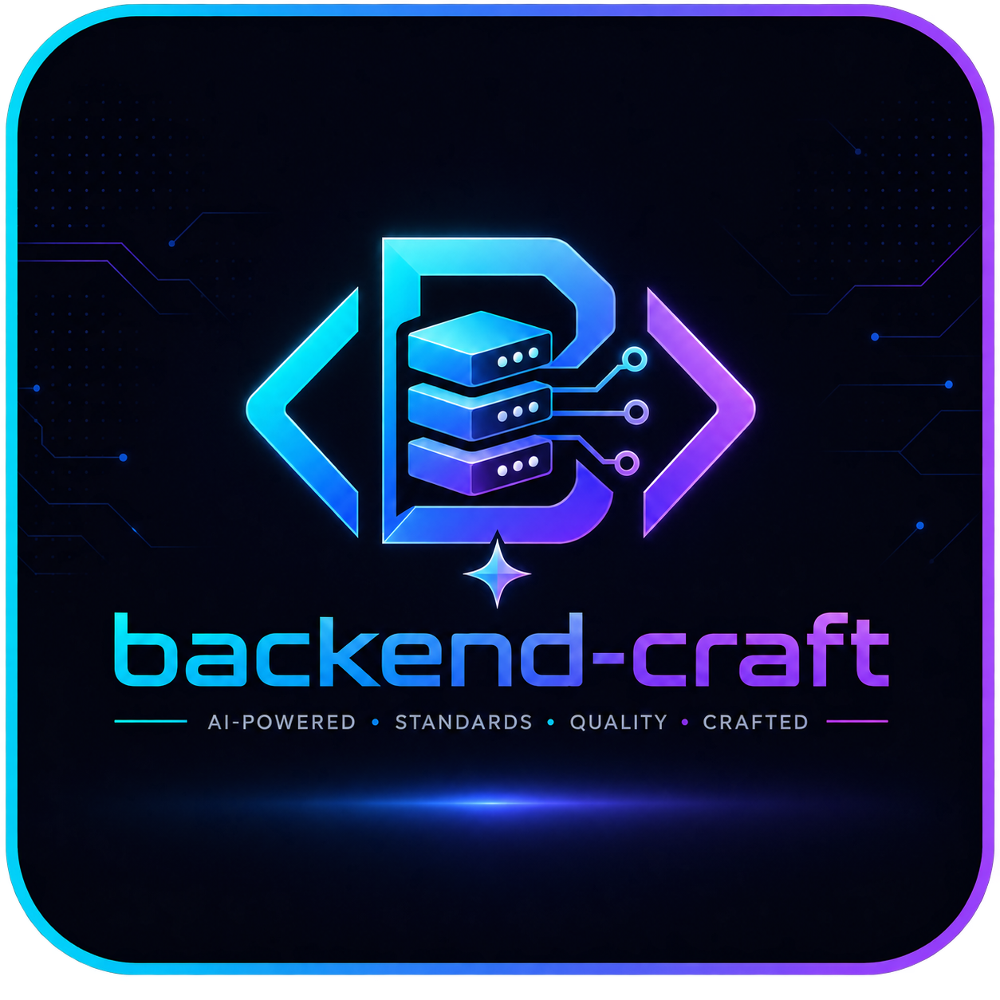

<div align="center">



# Backend Craft

### AI コーディングアシスタントにバックエンドの開発規約とワークフローを。

[](https://github.com/bovinphang/backend-craft/actions/workflows/ci.yml)
[](https://www.npmjs.com/package/@bovinphang/backend-craft)
[](../../LICENSE)


**🌐 Language / 语言 / 語言 / 言語 / 언어**

[English](../../README.md) · [简体中文](../../README.zh-CN.md) · [繁體中文](../../docs/zh-TW/README.md) · [**日本語**](../../docs/ja-JP/README.md) · [한국어](../../docs/ko-KR/README.md)

</div>

Backend Craft は、アーキテクチャ、API、データ、セキュリティ、テスト、障害診断のワークフローを、次の **15 の AI コーディングアシスタント**に提供します。

`claude` `codex` `cursor` `windsurf` `opencode`
`kilo` `gemini` `copilot` `antigravity` `augment`
`trae` `codebuddy` `cline` `openclaw` `qoder`

ランタイムごとのパスと注意事項は、[ランタイムガイド](../../docs/runtimes/README.md)を参照してください。

**21 のバックエンドスキル**、**21 の共通エンジニアリングスキル**、**8 のエージェント**、**8 のコマンドワークフロー**を含みます。README は 5 言語で提供されます。インストール可能なスキル、エージェント、コマンドワークフローは英語と簡体字中国語に対応しています。

Rust、Go、Java、Python、C、C++ のサービス開発を対象とし、Spring Boot、FastAPI、Gin、Axum、Drogon の専用スキルを提供します。共通の `cc-*` 基盤は TypeScript、Electron、Tauri も対象とします。

[ドキュメント](../../docs/README.md) · [プロンプト例](../../docs/example-prompts.md) · [貢献ガイド](../../CONTRIBUTING.md) · [変更履歴](../../CHANGELOG.md)

## 主な機能

- アーキテクチャ、API、ストレージ、キャッシュ、トランザクションのワークフローでサービスの発展を計画します。
- 既存プロジェクトの規約に従い、共通の言語標準と 5 つのフレームワーク向け専門スキルを適用します。
- コード、セキュリティ、パフォーマンス、デバッグ、テスト計画の専用エージェントを利用します。
- プロジェクトを調査し、検証計画をプレビューして既存のローカルツールでチェックを実行します。
- ランタイム別リソースを生成し、所有関係を追跡して Frontend Craft と共通コンテンツを共有します。

**スキル**はタスク別の規約や手法、**エージェント**は専門的な開発タスク、**コマンドワークフロー**は対応ホストでの呼び出し入口を提供します。ターミナルの `bec setup` などの CLI コマンドとは異なります。

## クイックスタート

**Node.js 22+**、インストール済みの AI コーディングアシスタント、既存のバックエンドプロジェクトを用意してください。CLI は Windows、macOS、Linux に対応します。

### 1. インストールと接続

```sh
npm install -g @bovinphang/backend-craft@latest
cd your-backend-project
bec setup
```

`your-backend-project` を実際のプロジェクトディレクトリに置き換えてください。対話式ターミナルの `bec setup` で AI ランタイム（アシスタント）を 1 つ以上選択し、英語または簡体字中国語のリソースを選びます。矢印キーで移動、Space で選択・解除、Enter で確定します。初期状態では Claude が選択されています。他のアシスタントだけを使う場合は解除してください。既定では**現在のプロジェクト**にインストールします。

対話を省略する場合やスクリプトでは、ランタイム、範囲、言語を明示します。Codex の例：

```sh
bec setup codex --local --lang en
```

### 2. インストールの確認

同じプロジェクトディレクトリで確認します。以下は Codex の例です。`codex` を[対応一覧](../../docs/runtimes/README.md)から選んだランタイムの識別子に置き換え、選択したものをそれぞれ確認してください。

```sh
bec doctor codex --local --json
```

`installed: true` は管理対象のインストールが存在すること、`filesHealthy: true` はリソースが正常であることを示します。`enabled: "unknown"` はアシスタント内での有効化を CLI が確認できないことを意味します。前の 2 項目が false の場合は診断情報と[ランタイムガイド](../../docs/runtimes/README.md)を確認してください。

### 3. 最初のタスク

アシスタントを更新または再起動し、対象プロジェクトで新しい会話を開始します。リソースが検出されていることを確認し、必要ならホストの信頼・有効化操作を行ってください。スキル対応のアシスタントでは次のプロンプトを使えます。`services/orders` は実在するモジュールのパスに置き換えてください。

```text
bec-code-review を使い、services/orders をコード変更なしでレビューしてください。
リポジトリの規約に従い、認可、トランザクション境界、エラー処理を重点的に確認してください。
問題の場所、影響、修正案を示し、問題がなければ明記してください。
```

問題の場所・影響・修正案、または問題なしという結果を確認します。Claude Code は `/bec-review` や `/bec-debug` も提供し、Codex はスキルとエージェントを使用します。ホストごとの違いは[ランタイムガイド](../../docs/runtimes/README.md)、その他のタスクは[プロンプト例](../../docs/example-prompts.md)を参照してください。

## その他のインストール方法

### npx による一時実行

グローバル CLI をインストールしない場合の方法です。以降の CLI コマンドにも `npx @bovinphang/backend-craft@latest` を付けて実行してください。

```sh
cd your-backend-project
npx @bovinphang/backend-craft@latest setup
```

### Claude Code ネイティブプラグイン

Claude Code 内で以下を実行します。ランタイムごとにインストール経路を 1 つ選んでください。同じランタイムで CLI 接続とネイティブプラグインは併用できません。有効化と経路の切り替えは[ランタイムガイド](../../docs/runtimes/README.md)を参照してください。

```text
/plugin marketplace add bovinphang/backend-craft
/plugin install backend-craft@backend-craft
```

### ユーザー全体へのインストール

プロジェクト間で共用する場合は `--global` でユーザー全体にインストールします。以下は Codex の例です。意図せずローカルとグローバルの両方にインストールしないよう範囲を選んでください。一括操作と既定値は [CLI 管理](../../docs/cli-management.md)を参照してください。

```sh
bec setup codex --global --lang en
```

## 機能一覧

### バックエンドスキル

| 分野 | スキル |
| --- | --- |
| サービス設計 | `bec-architecture-design`, `bec-api-design` |
| データと整合性 | `bec-database-design`, `bec-cache-design`, `bec-transaction-management` |
| セキュリティと運用 | `bec-auth-security`, `bec-observability`, `bec-performance-optimization` |
| デリバリーと保守 | `bec-project-init`, `bec-code-review`, `bec-debug-framework`, `bec-testing-strategy`, `bec-tdd-workflow`, `bec-refactoring`, `bec-dependency-management`, `bec-doc-sync` |
| サービスフレームワーク | `bec-spring-boot-project-standard`, `bec-fastapi-project-standard`, `bec-gin-project-standard`, `bec-axum-project-standard`, `bec-drogon-project-standard` |

### 共通エンジニアリングスキル

| 分野 | スキル |
| --- | --- |
| 言語 | `cc-typescript-project-standard`, `cc-rust-project-standard`, `cc-go-project-standard`, `cc-java-project-standard`, `cc-python-project-standard`, `cc-c-project-standard`, `cc-cpp-project-standard` |
| ランタイムと並行処理 | `cc-rust-async`, `cc-go-concurrency`, `cc-java-runtime`, `cc-python-async`, `cc-native-memory-safety` |
| デスクトップ | `cc-electron-project-standard`, `cc-tauri-project-standard` |
| エンジニアリング手法 | `cc-source-driven-development`, `cc-doc-sync-core`, `cc-debug-methodology`, `cc-refactoring-core`, `cc-tdd-methodology` |
| 図表 | `cc-drawio-studio`, `cc-technical-diagrams` |

### エージェント

| エージェント | 用途 |
| --- | --- |
| `bec-architect` | アーキテクチャとモジュール境界の計画 |
| `bec-code-reviewer` | バックエンドコードレビュー |
| `bec-security-reviewer` | 認証・認可とサービスセキュリティのレビュー |
| `bec-performance-optimizer` | パフォーマンスの診断と最適化 |
| `bec-debugger` | 障害診断と検証済み修正 |
| `bec-test-planner` | リスクに基づくテスト戦略 |
| `bec-refactoring-expert` | 動作を維持するリファクタリング |
| `bec-doc-updater` | ドキュメントの同期 |

### アシスタントコマンド

| コマンド | 用途 |
| --- | --- |
| `/bec-init` | プロジェクトガイドの初期化 |
| `/bec-plan` | アーキテクチャまたはテストの計画 |
| `/bec-review` | バックエンドコードのレビュー |
| `/bec-debug` | 障害の診断と修正 |
| `/bec-tdd` | テスト駆動ワークフローの適用 |
| `/bec-refactor` | 動作検証を伴うリファクタリング |
| `/bec-doc-sync` | ドキュメントの同期 |
| `/bec-validate` | 検証のプレビューと実行 |

これらはアシスタント用ワークフローです。ターミナルでの検証には `bec validate` を使います。レポートは `reports/backend-craft/` に出力し、各エージェントがファイル名を指定します。

## 設定と検証

プロジェクトの検証には既存のツールチェーンとインストール済みの依存関係が必要です。

### プロジェクトの調査と検証

```sh
bec project inspect . --json
bec project inspect . --task-path services/api/main.go --task-kind api --json
bec validate . --dry-run --json
bec validate . --json
```

調査ではプロジェクトの情報を読み取り、適切な機能を推奨します。実行前に計画を確認してください。検証は明示設定、既存タスク、または言語別の保守的な候補を使用します。終了コードは成功が `0`、失敗が `1`、未完了または入力不正が `2` です。必須ツールの不足、必須段階のスキップ、テスト数ゼロでは成功になりません。

- [言語ガイド](../../docs/languages/README.md)では 6 つのプログラミング言語の検証を説明します。共通スキルの言語対応範囲は別途管理します。
- [検証設定](../../docs/validation-config.md)では `.backend-craft.json`、段階ごとの実行、テストの証拠を説明します。統合段階は明示的な有効化が必要です。
- 自動整形と自動検証は既定で無効です。Claude ネイティブの SessionStart は読み取り専用のコンテキストを提供します。OpenClaw ネイティブでは `autoValidate` を有効化でき、`formatStage` の設定後は `autoFormat` も有効化できます。
- [HTTP リプレイの例](../../skills/bec-api-design/examples/engineering/README.md)では冪等性のシナリオを示します。

## 更新とアンインストール

```sh
bec update --dry-run
bec update
bec runtime update codex --local
bec runtime uninstall codex --local
bec uninstall --yes
```

`bec update` は元の npm/pnpm インストールを確認し、CLI と現在のプロジェクトおよびグローバルの管理対象リソースを更新します。`runtime update` はインストール済みコンテンツを使い、指定がなければ各インストールの言語を維持します。`bec uninstall` はリソースを残して CLI を削除します。先に検出済みの製品リソースを削除する場合は `--purge` を追加します。

変更済みファイルと未知のファイルは保護されます。共有する `cc-*` リソースは共通パッケージのバージョン、言語、コンテンツダイジェストが一致する必要があります。混在するインストールの更新前に、対象ランタイムと範囲を指定して `bec runtime check-migration codex --local --json` を実行してください。[共存と移行](../../docs/coexistence.md)を参照してください。

## ドキュメント

| ガイド | 内容 |
| --- | --- |
| [ランタイムの導入と有効化](../../docs/runtimes/README.md) | 対応アシスタント、パス、リソース検出 |
| [CLI 管理](../../docs/cli-management.md) | インストール範囲、一括操作、更新、削除 |
| [プロンプト例](../../docs/example-prompts.md) | 設計、レビュー、障害診断 |
| [検証設定](../../docs/validation-config.md) | プロジェクトのチェックとテストの証拠 |
| [共存と移行](../../docs/coexistence.md) | 共有リソースと競合 |
| [ドキュメント一覧](../../docs/README.md) | 言語ガイド、構成、拡張 |

## ソース開発と貢献

このリポジトリではバックエンド固有のスキル、エージェント、ワークフローを管理します。共通の `cc-*` スキルと手法は [craft-common](https://github.com/bovinphang/craft-common) で管理し、`pnpm build` で英語・簡体字中国語の製品全体を `dist/package/` に生成します。ローカル開発と Git サブモジュールではこのディレクトリを読み込んでください。

Node.js 22+ と `package.json` 指定の pnpm を使用します。依存バージョンは `package.json` と `pnpm-lock.yaml` に従います。次の順に実行してください。

```sh
git clone https://github.com/bovinphang/backend-craft.git
cd backend-craft
pnpm install --frozen-lockfile
pnpm build
node dist/package/dist/bin/backend-craft.js version
```

ビルド済みの Claude プラグインはリポジトリルートから読み込みます：

```sh
claude --plugin-dir ./dist/package
```

開発チェック、英語・簡体字中国語コンテンツの保守、配布用アーカイブ（`pnpm run pack:all`）は[貢献ガイド](../../CONTRIBUTING.md)を参照してください。再現可能な問題は [GitHub Issues](https://github.com/bovinphang/backend-craft/issues) に報告してください。

## ライセンス

[MIT](../../LICENSE) © bovinphang.
