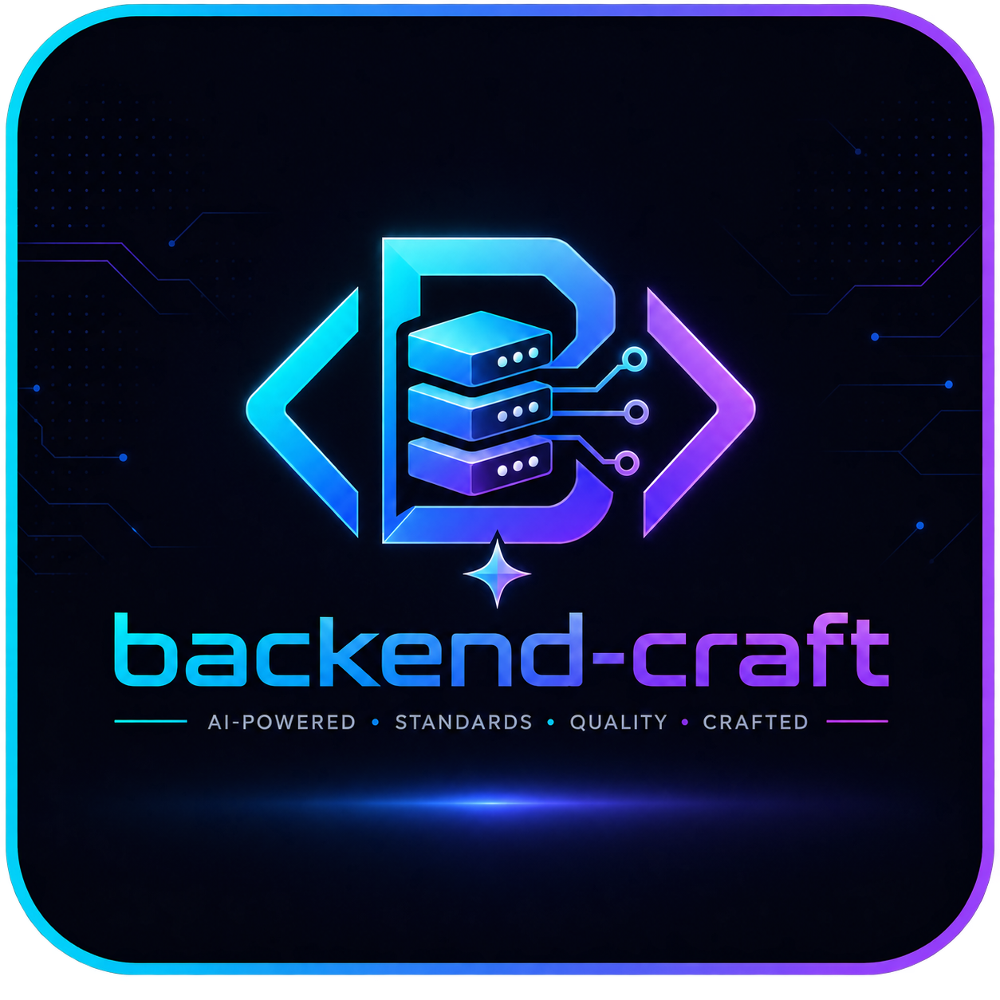

<div align="center">



# Backend Craft

### AI 코딩 도우미에 백엔드 개발 규칙과 워크플로를 연결하세요.

[](https://github.com/bovinphang/backend-craft/actions/workflows/ci.yml)
[](https://www.npmjs.com/package/@bovinphang/backend-craft)
[](../../LICENSE)


**🌐 Language / 语言 / 語言 / 言語 / 언어**

[English](../../README.md) · [简体中文](../../README.zh-CN.md) · [繁體中文](../../docs/zh-TW/README.md) · [日本語](../../docs/ja-JP/README.md) · [**한국어**](../../docs/ko-KR/README.md)

</div>

Backend Craft는 아키텍처, API, 데이터, 보안, 테스트 및 문제 진단 워크플로를 다음 **15개 AI 코딩 도우미**에 제공합니다.

`claude` `codex` `cursor` `windsurf` `opencode`
`kilo` `gemini` `copilot` `antigravity` `augment`
`trae` `codebuddy` `cline` `openclaw` `qoder`

런타임별 경로와 주의 사항은 [런타임 가이드](../../docs/runtimes/README.md)를 참조하세요.

**백엔드 스킬 21개**, **공통 엔지니어링 스킬 21개**, **에이전트 8개**, **명령 워크플로 8개**를 포함합니다. README는 5개 언어로 제공됩니다. 설치 가능한 스킬, 에이전트 및 명령 워크플로는 영어와 중국어 간체로 제공됩니다.

Rust, Go, Java, Python, C, C++ 서비스 개발을 지원하며 Spring Boot, FastAPI, Gin, Axum, Drogon 전용 스킬을 제공합니다. 공통 `cc-*` 기반은 TypeScript, Electron, Tauri도 지원합니다.

[문서](../../docs/README.md) · [프롬프트 예시](../../docs/example-prompts.md) · [기여 안내](../../CONTRIBUTING.md) · [변경 이력](../../CHANGELOG.md)

## 주요 기능

- 아키텍처, API, 스토리지, 캐시 및 트랜잭션 워크플로로 서비스 발전을 계획합니다.
- 기존 프로젝트 규칙에 따라 공통 언어 표준과 5개 프레임워크 전용 스킬을 적용합니다.
- 코드, 보안, 성능, 디버깅 및 테스트 계획 전용 에이전트를 사용합니다.
- 프로젝트를 분석하고 검증 계획을 미리 확인한 후 기존 로컬 도구로 검사를 실행합니다.
- 런타임별 리소스를 생성하고 소유 관계를 추적하며 Frontend Craft와 공통 콘텐츠를 공유합니다.

**스킬**은 작업별 규칙과 방법을 제공하고, **에이전트**는 전문 개발 작업을 담당하며, **명령 워크플로**는 지원 호스트에서 호출 진입점을 제공합니다. 터미널의 `bec setup` 같은 CLI 명령과 구분됩니다.

## 빠른 시작

**Node.js 22+**, 설치된 AI 코딩 도우미와 기존 백엔드 프로젝트를 준비하세요. CLI는 Windows, macOS, Linux를 지원합니다.

### 1. 설치 및 도우미 연결

```sh
npm install -g @bovinphang/backend-craft@latest
cd your-backend-project
bec setup
```

`your-backend-project`를 실제 프로젝트 경로로 바꾸세요. 대화형 터미널에서 `bec setup`으로 AI 런타임(코딩 도우미)을 하나 이상 선택한 다음 영어 또는 중국어 간체 리소스를 선택합니다. 방향키로 이동하고 Space로 선택·해제한 후 Enter로 확정하세요. 처음에는 Claude가 선택되어 있으므로 다른 도우미만 사용하려면 해제하세요. 기본적으로 **현재 프로젝트**에 설치합니다.

대화형 선택을 생략하거나 스크립트에서 실행하려면 런타임, 범위와 언어를 지정하세요. Codex 예시:

```sh
bec setup codex --local --lang en
```

### 2. 설치 확인

같은 프로젝트 디렉터리에서 확인하세요. 아래는 Codex 예시입니다. `codex`를 [지원 목록](../../docs/runtimes/README.md)에서 선택한 런타임 식별자로 바꾸고 선택한 런타임마다 확인하세요.

```sh
bec doctor codex --local --json
```

`installed: true`는 관리 대상 설치가 있음을, `filesHealthy: true`는 리소스가 정상임을 뜻합니다. `enabled: "unknown"`은 CLI가 도우미 내부의 활성화 상태를 확인할 수 없다는 뜻입니다. 앞의 두 항목이 false이면 진단 결과와 [런타임 가이드](../../docs/runtimes/README.md)를 확인하세요.

### 3. 첫 작업 실행

도우미를 새로 고치거나 다시 시작하고 대상 프로젝트에서 새 대화를 여세요. 설치한 리소스가 검색되는지 확인하고 호스트가 요구하면 신뢰 또는 활성화 절차를 완료하세요. 스킬을 지원하는 도우미에서는 다음 프롬프트를 사용할 수 있습니다. `services/orders`를 실제 모듈 경로로 바꾸세요.

```text
bec-code-review로 services/orders를 읽기 전용으로 검토하고 코드는 수정하지 마세요.
저장소 규칙을 따르고 인가, 트랜잭션 경계 및 오류 처리를 우선 확인하세요.
문제 위치, 영향과 수정 제안을 제시하고 문제가 없으면 명시하세요.
```

문제 위치·영향·수정 제안 또는 문제가 없다는 결과를 확인하세요. Claude Code는 `/bec-review`, `/bec-debug`도 제공하며 Codex는 스킬과 에이전트를 사용합니다. 호스트별 리소스는 [런타임 가이드](../../docs/runtimes/README.md), 추가 작업은 [프롬프트 예시](../../docs/example-prompts.md)를 참조하세요.

## 다른 설치 방법

### npx로 임시 실행

전역 CLI를 설치하지 않을 때 사용하는 방법입니다. 이후 CLI 명령도 `npx @bovinphang/backend-craft@latest`를 붙여 실행하세요.

```sh
cd your-backend-project
npx @bovinphang/backend-craft@latest setup
```

### Claude Code 네이티브 플러그인

Claude Code 안에서 다음 명령을 실행하세요. 런타임마다 설치 경로를 하나만 선택하세요. 같은 런타임에서 CLI 연결과 네이티브 플러그인을 함께 설치할 수 없습니다. 활성화와 설치 경로 전환은 [런타임 가이드](../../docs/runtimes/README.md)를 참조하세요.

```text
/plugin marketplace add bovinphang/backend-craft
/plugin install backend-craft@backend-craft
```

### 사용자 전역 설치

여러 프로젝트에서 공유하려면 `--global`로 사용자 전역에 설치하세요. 다음은 Codex 예시입니다. 의도하지 않게 로컬과 전역에 중복 설치하지 않도록 범위를 선택하세요. 일괄 작업과 전체 기본값은 [CLI 관리](../../docs/cli-management.md)를 참조하세요.

```sh
bec setup codex --global --lang en
```

## 기능 목록

### 백엔드 스킬

| 영역 | 스킬 |
| --- | --- |
| 서비스 설계 | `bec-architecture-design`, `bec-api-design` |
| 데이터 및 일관성 | `bec-database-design`, `bec-cache-design`, `bec-transaction-management` |
| 보안 및 운영 | `bec-auth-security`, `bec-observability`, `bec-performance-optimization` |
| 제공 및 유지보수 | `bec-project-init`, `bec-code-review`, `bec-debug-framework`, `bec-testing-strategy`, `bec-tdd-workflow`, `bec-refactoring`, `bec-dependency-management`, `bec-doc-sync` |
| 서비스 프레임워크 | `bec-spring-boot-project-standard`, `bec-fastapi-project-standard`, `bec-gin-project-standard`, `bec-axum-project-standard`, `bec-drogon-project-standard` |

### 공통 엔지니어링 스킬

| 영역 | 스킬 |
| --- | --- |
| 언어 | `cc-typescript-project-standard`, `cc-rust-project-standard`, `cc-go-project-standard`, `cc-java-project-standard`, `cc-python-project-standard`, `cc-c-project-standard`, `cc-cpp-project-standard` |
| 런타임 및 동시성 | `cc-rust-async`, `cc-go-concurrency`, `cc-java-runtime`, `cc-python-async`, `cc-native-memory-safety` |
| 데스크톱 | `cc-electron-project-standard`, `cc-tauri-project-standard` |
| 엔지니어링 방법 | `cc-source-driven-development`, `cc-doc-sync-core`, `cc-debug-methodology`, `cc-refactoring-core`, `cc-tdd-methodology` |
| 다이어그램 | `cc-drawio-studio`, `cc-technical-diagrams` |

### 에이전트

| 에이전트 | 용도 |
| --- | --- |
| `bec-architect` | 아키텍처 및 모듈 경계 계획 |
| `bec-code-reviewer` | 백엔드 코드 검토 |
| `bec-security-reviewer` | 인증, 권한 부여 및 서비스 보안 검토 |
| `bec-performance-optimizer` | 성능 진단 및 최적화 |
| `bec-debugger` | 장애 진단 및 검증된 수정 |
| `bec-test-planner` | 위험 기반 테스트 전략 |
| `bec-refactoring-expert` | 동작을 유지하는 리팩터링 |
| `bec-doc-updater` | 문서 동기화 |

### 도우미 명령

| 명령 | 용도 |
| --- | --- |
| `/bec-init` | 프로젝트 지침 초기화 |
| `/bec-plan` | 아키텍처 또는 테스트 계획 |
| `/bec-review` | 백엔드 코드 검토 |
| `/bec-debug` | 장애 진단 및 수정 |
| `/bec-tdd` | 테스트 주도 워크플로 적용 |
| `/bec-refactor` | 동작 검증을 포함한 리팩터링 |
| `/bec-doc-sync` | 문서 동기화 |
| `/bec-validate` | 검증 미리 확인 및 실행 |

이 명령은 도우미 워크플로입니다. 터미널 검증에는 `bec validate`를 사용하세요. 보고서는 `reports/backend-craft/`에 저장되며 각 에이전트가 파일명을 지정합니다.

## 설정 및 검증

프로젝트 검증에는 기존 도구 체인과 설치된 의존성이 필요합니다.

### 프로젝트 분석 및 검증

```sh
bec project inspect . --json
bec project inspect . --task-path services/api/main.go --task-kind api --json
bec validate . --dry-run --json
bec validate . --json
```

분석은 프로젝트 근거를 읽고 적합한 기능을 추천합니다. 실행 전에 계획을 검토하세요. 검증은 명시적 설정, 기존 프로젝트 작업 또는 언어별 보수적 제안을 사용합니다. 종료 코드는 통과 `0`, 실패 `1`, 불완전 또는 잘못된 입력 `2`입니다. 필수 도구 누락, 필수 단계 건너뛰기 또는 테스트 0개인 경우 통과할 수 없습니다.

- [언어 가이드](../../docs/languages/README.md)는 6개 프로그래밍 언어의 검증을 설명합니다. 공통 스킬의 언어 지원 범위는 별도로 관리합니다.
- [검증 설정](../../docs/validation-config.md)은 `.backend-craft.json`, 단계 실행 및 테스트 근거를 설명합니다. 통합 단계는 명시적으로 활성화해야 합니다.
- 자동 서식 지정과 검증은 기본적으로 꺼져 있습니다. Claude 네이티브 SessionStart는 읽기 전용 컨텍스트를 제공합니다. OpenClaw 네이티브에서는 `autoValidate`를 켤 수 있으며 `formatStage`를 설정하면 `autoFormat`도 켤 수 있습니다.
- [HTTP 재실행 예시](../../skills/bec-api-design/examples/engineering/README.md)는 멱등성 시나리오를 보여줍니다.

## 업데이트 및 제거

```sh
bec update --dry-run
bec update
bec runtime update codex --local
bec runtime uninstall codex --local
bec uninstall --yes
```

`bec update`는 원래 npm/pnpm 설치를 확인하고 CLI를 업그레이드한 뒤 현재 프로젝트와 전역의 관리 리소스를 갱신합니다. `runtime update`는 설치된 콘텐츠를 사용하며 재정의하지 않으면 각 설치의 언어를 유지합니다. `bec uninstall`은 리소스를 유지하고 CLI를 제거합니다. 발견된 제품 리소스를 먼저 정리하려면 `--purge`를 추가하세요.

수정된 파일과 알 수 없는 파일은 보호됩니다. 공유 `cc-*` 리소스는 공통 패키지 버전, 언어 및 콘텐츠 다이제스트가 일치해야 합니다. 혼합 설치를 업그레이드하기 전에 해당 런타임과 범위로 `bec runtime check-migration codex --local --json`을 실행하세요. [공존 및 마이그레이션](../../docs/coexistence.md)을 참조하세요.

## 문서

| 가이드 | 내용 |
| --- | --- |
| [런타임 설치 및 활성화](../../docs/runtimes/README.md) | 지원 도우미, 경로와 리소스 검색 |
| [CLI 관리](../../docs/cli-management.md) | 설치 범위, 일괄 작업, 업데이트와 제거 |
| [프롬프트 예시](../../docs/example-prompts.md) | 설계, 검토와 문제 진단 |
| [검증 설정](../../docs/validation-config.md) | 프로젝트 검사 및 테스트 근거 |
| [공존 및 마이그레이션](../../docs/coexistence.md) | 공유 리소스와 충돌 |
| [전체 문서](../../docs/README.md) | 언어 가이드, 구조 및 확장 |

## 소스 개발 및 기여

이 저장소는 백엔드 전용 스킬, 에이전트와 워크플로를 관리합니다. 공통 `cc-*` 스킬과 개발 방법은 [craft-common](https://github.com/bovinphang/craft-common)에서 관리하며 `pnpm build`가 영어·중국어 간체 제품 전체를 `dist/package/`에 생성합니다. 로컬 개발과 Git 서브모듈에서는 이 디렉터리를 불러오세요.

Node.js 22+와 `package.json`에 지정된 pnpm을 사용하세요. 의존성 버전은 `package.json`과 `pnpm-lock.yaml`을 따릅니다. 다음 순서로 실행하세요.

```sh
git clone https://github.com/bovinphang/backend-craft.git
cd backend-craft
pnpm install --frozen-lockfile
pnpm build
node dist/package/dist/bin/backend-craft.js version
```

빌드한 Claude 플러그인은 저장소 루트에서 다음 명령으로 불러오세요:

```sh
claude --plugin-dir ./dist/package
```

개발 검사, 영어·중국어 간체 유지보수 및 배포 아카이브(`pnpm run pack:all`)는 [기여 안내](../../CONTRIBUTING.md)를 참조하세요. 재현 가능한 문제는 [GitHub Issues](https://github.com/bovinphang/backend-craft/issues)로 제보하세요.

## 라이선스

[MIT](../../LICENSE) © bovinphang.
