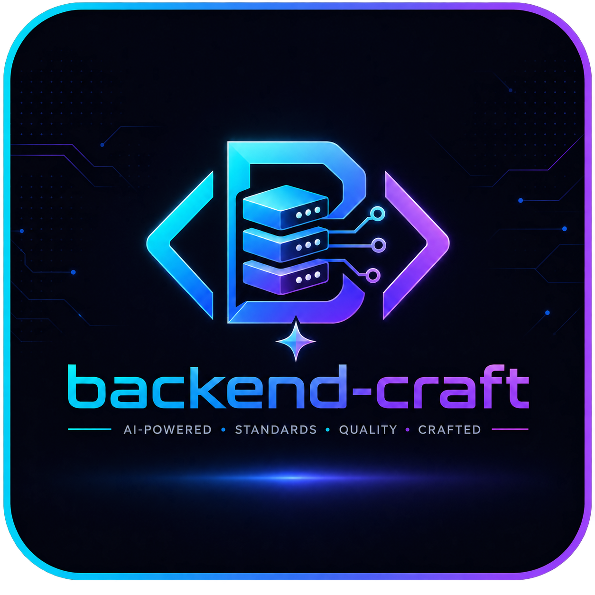

<div align="center">



# Backend Craft

### 一套工具，適配所有 AI 程式設計助手，落地生產級後端規範。

[](https://github.com/bovinphang/backend-craft/actions/workflows/ci.yml)
[](https://www.npmjs.com/package/@bovinphang/backend-craft)
[](../../LICENSE)


**🌐 Language / 语言 / 語言 / 言語 / 언어**

[English](../../README.md) · [简体中文](../../README.zh-CN.md) · [**繁體中文**](../../docs/zh-TW/README.md) · [日本語](../../docs/ja-JP/README.md) · [한국어](../../docs/ko-KR/README.md)

</div>

Backend Craft 將架構、API、資料、安全、測試與故障診斷工作流接入以下 **15 款 AI 程式設計助手**：

`claude` `codex` `cursor` `windsurf` `opencode`
`kilo` `gemini` `copilot` `antigravity` `augment`
`trae` `codebuddy` `cline` `openclaw` `qoder`

各 Runtime 的路徑與注意事項詳見 [Runtime 指南](../../docs/runtimes/README.zh-CN.md)。

提供 **21 個後端 Skill**、**21 個公共工程 Skill**、**8 個 Agent** 與 **8 個命令工作流**。README 提供五種語言版本；可安裝的 Skill、Agent 和命令工作流提供英文、簡體中文內容。

服務工程覆蓋 Rust、Go、Java、Python、C、C++，提供 Spring Boot、FastAPI、Gin、Axum、Drogon 專項。公共 `cc-*` 底座還覆蓋 TypeScript、Electron、Tauri。

[文件導航](../../docs/README.zh-CN.md) · [示例提示詞](../../docs/example-prompts.zh-CN.md) · [貢獻指南](../../CONTRIBUTING.zh-CN.md) · [變更日誌](../../CHANGELOG.zh-CN.md)

## 核心能力

- 使用架構、API、儲存、快取和交易工作流規劃服務演進。
- 結合公共語言規範與五個框架專項，遵循已有專案約定。
- 使用程式碼、安全、效能、除錯和測試規劃 Agent 處理工程任務。
- 只讀識別專案，預覽驗證計劃，使用現有本地工具執行檢查。
- 為不同助手生成適配資源，跟蹤所有權，並與 Frontend Craft 共享公共內容。

## 安裝

要求 **Node.js 22+**，CLI 面向 Windows、macOS 和 Linux。後端驗證還需要專案已有工具鏈及準備完成的依賴。

### 全域 CLI

```sh
npm install -g @bovinphang/backend-craft@latest
cd your-backend-project
bec runtime install codex --local --lang zh-CN
bec doctor codex --local --json
```

npm 命令安裝 `bec` 和 `backend-craft` 終端命令，`runtime install` 將指定 Runtime 接入專案。使用者級接入使用 `--global`，英文資源使用 `--lang en`。

### 臨時 npx 執行

```sh
cd your-backend-project
npx @bovinphang/backend-craft@latest runtime install codex --local --lang zh-CN
npx @bovinphang/backend-craft@latest matrix --json
```

### Claude Code 原生外掛

在 Claude Code 內新增 Marketplace 並安裝外掛。

```text
/plugin marketplace add bovinphang/backend-craft
/plugin install backend-craft@backend-craft
```

從本地原始碼載入外掛時，先構建，再在倉庫根目錄執行 `claude --plugin-dir .`。詳見 [Runtime 安裝指南](../../docs/runtimes/README.zh-CN.md)。

每個 Runtime 選擇一種安裝渠道。安裝後重新整理宿主，在宿主中確認發現與啟用狀態。

### 從原始碼構建

在倉庫根目錄使用 pnpm 12.4.1 構建 CLI，再用 Node.js 直接執行。當前原始碼精確依賴 `@bovinphang/craft-common@2.1.0`。

```sh
pnpm install --frozen-lockfile
pnpm build
node dist/bin/backend-craft.js setup codex --local --lang zh-CN --dry-run --json
```

### 接入 Runtime

安裝 CLI 後，在目標專案目錄執行以下命令。`setup` 要求 Backend Craft 1.1.0 或更高版本。

```sh
bec setup
bec setup codex --local --lang zh-CN
bec setup all --local --lang zh-CN
bec runtime install --all --global --lang zh-CN --dry-run --json
```

`setup` 預設接入當前專案。普通互動安裝詢問 Runtime、語言與位置；普通非互動安裝預設 Claude、全域、英文。指令碼中顯式指定 `--local` 或 `--global`。詳見 [CLI 管理](../../docs/cli-management.zh-CN.md)。

## 快速開始

### 識別和驗證專案

```sh
bec project inspect . --json
bec project inspect . --task-path services/api/main.go --task-kind api --json
bec validate . --dry-run --json
bec validate . --json
```

識別讀取工程證據並推薦適用能力。執行前先審閱驗證計劃。驗證使用顯式配置、專案已有任務或保守語言候選。退出碼 `0` 表示透過，`1` 表示失敗，`2` 表示不完整或輸入無效。缺少必需工具、必需階段被跳過、零測試均無法透過。

### 與助手協作

```text
按照本倉庫架構與 API 約定規劃訂單服務。
評審 services/orders 中的授權與事務邊界。
診斷這個 Go 取消傳播問題，用現有測試驗證修復。
```

Claude Code 提供 `/bec-review`、`/bec-debug` 等工作流。Codex 透過 Skill 和 Agent 完成任務，其他宿主的資源形式見 [Runtime 指南](../../docs/runtimes/README.zh-CN.md)。

## 能力目錄

### 後端 Skill

| 領域 | Skill |
| --- | --- |
| 服務設計 | `bec-architecture-design`、`bec-api-design` |
| 資料與一致性 | `bec-database-design`、`bec-cache-design`、`bec-transaction-management` |
| 安全與執行保障 | `bec-auth-security`、`bec-observability`、`bec-performance-optimization` |
| 交付與維護 | `bec-project-init`、`bec-code-review`、`bec-debug-framework`、`bec-testing-strategy`、`bec-tdd-workflow`、`bec-refactoring`、`bec-dependency-management`、`bec-doc-sync` |
| 服務框架 | `bec-spring-boot-project-standard`、`bec-fastapi-project-standard`、`bec-gin-project-standard`、`bec-axum-project-standard`、`bec-drogon-project-standard` |

### 公共工程 Skill

| 領域 | Skill |
| --- | --- |
| 語言 | `cc-typescript-project-standard`、`cc-rust-project-standard`、`cc-go-project-standard`、`cc-java-project-standard`、`cc-python-project-standard`、`cc-c-project-standard`、`cc-cpp-project-standard` |
| 執行時與併發 | `cc-rust-async`、`cc-go-concurrency`、`cc-java-runtime`、`cc-python-async`、`cc-native-memory-safety` |
| 桌面 | `cc-electron-project-standard`、`cc-tauri-project-standard` |
| 工程方法 | `cc-source-driven-development`、`cc-doc-sync-core`、`cc-debug-methodology`、`cc-refactoring-core`、`cc-tdd-methodology` |
| 圖表 | `cc-drawio-studio`、`cc-technical-diagrams` |

### Agent

| Agent | 用途 |
| --- | --- |
| `bec-architect` | 架構與模組邊界規劃 |
| `bec-code-reviewer` | 後端程式碼評審 |
| `bec-security-reviewer` | 認證、授權與服務安全評審 |
| `bec-performance-optimizer` | 效能診斷與最佳化 |
| `bec-debugger` | 故障診斷與驗證修復 |
| `bec-test-planner` | 基於風險的測試策略 |
| `bec-refactoring-expert` | 保持行為的重構 |
| `bec-doc-updater` | 文件同步 |

### 助手命令

| 命令 | 用途 |
| --- | --- |
| `/bec-init` | 初始化專案指導內容 |
| `/bec-plan` | 架構或測試規劃 |
| `/bec-review` | 後端程式碼評審 |
| `/bec-debug` | 診斷與修復故障 |
| `/bec-tdd` | 測試驅動工作流 |
| `/bec-refactor` | 結合行為驗證重構 |
| `/bec-doc-sync` | 同步專案文件 |
| `/bec-validate` | 預覽和執行工程驗證 |

這些是助手工作流，終端驗證使用 `bec validate`。報告寫入 `reports/backend-craft/`，Agent 在該目錄使用各自定義的檔名。

## 配置與驗證

- [語言指南](../../docs/languages/README.zh-CN.md)介紹六語言驗證，公共 Skill 的語言覆蓋單獨維護。
- [驗證配置](../../docs/validation-config.zh-CN.md)介紹 `.backend-craft.json`、階段執行與測試證據，整合階段需顯式啟用。
- 自動格式與驗證預設關閉。Claude 原生 SessionStart Hook 提供只讀上下文；OpenClaw 原生外掛可開啟 `autoValidate`，配置 `formatStage` 後可開啟 `autoFormat`。
- [HTTP 重放樣例](../../skills/bec-api-design/examples/engineering/README.md)演示冪等場景。

## 更新與解除安裝

CLI 自管理命令 `bec update` 和 `bec uninstall` 要求 Backend Craft 1.1.0 或更高版本。

```sh
bec update --dry-run
bec update
bec runtime update codex --local --dry-run --json
bec runtime update codex --local
bec runtime uninstall codex --local --dry-run --json
bec runtime uninstall codex --local
bec uninstall --yes
```

`bec update` 核實原 npm/pnpm 來源，升級 CLI 後重新整理當前專案及全域託管資源。`runtime update` 使用當前包內容，預設沿用每個安裝的語言。`bec uninstall` 解除安裝 CLI 並保留資源，新增 `--purge` 可先清理發現的本產品資源。

使用者修改與未知檔案受到保護。跨產品共享 `cc-*` 要求公共包版本、語言與內容摘要一致。升級混合安裝前，按實際 Runtime 和安裝範圍執行 `bec runtime check-migration codex --local --json`。詳見[共存與遷移](../../docs/coexistence.zh-CN.md)。

## 文件

[文件導航](../../docs/README.zh-CN.md)彙總安裝、提示詞、配置、遷移和維護入口。

## 貢獻

[貢獻指南](../../CONTRIBUTING.zh-CN.md)介紹開發環境、雙語維護和校驗流程。透過 [GitHub Issues](https://github.com/bovinphang/backend-craft/issues)反饋可復現問題。

## 許可證

[MIT](../../LICENSE) © bovinphang。

公共內容在 craft-common 統一維護。本原始碼倉庫僅儲存領域技能；`pnpm run build` 在 `dist/package/` 生成完整雙語產品。開發及 Git 子模組使用 `--plugin-dir <仓库>/dist/package`。發行歸檔透過 `pnpm run pack:all` 生成，具體步驟見 CONTRIBUTING.zh-CN.md。
